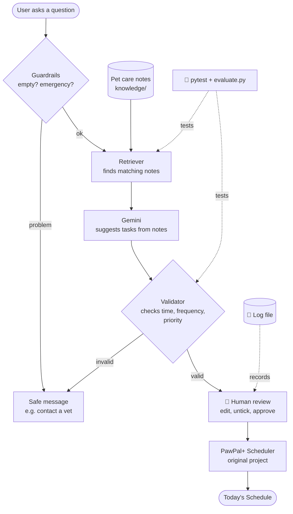

# 🐾 PawPal+ AI: A Pet Care Advisor with RAG and Human Approval

PawPal+ AI helps pet owners build a daily care routine. You ask a question in plain English, like
*"What should my 3-month-old puppy eat?"*, and the system looks up cited pet care notes, asks Gemini to
suggest care tasks **based only on those notes**, checks every suggestion, and lets you edit and approve
them before they go on your schedule.

**Why it matters:** first-time pet owners often don't know what their pet needs or how often. A general
chatbot can sound confident while making things up. PawPal+ AI grounds its answers in sources like the
ASPCA, AKC, VCA and RSPCA, refuses to handle emergencies, and never adds anything without the owner's approval.

## Base Project: PawPal+ (Module 2)

This project extends **PawPal+**, my Module 2 project
([ai110-module2show-pawpal-starter](https://github.com/ImDoriFish/ai110-module2show-pawpal-starter)).
PawPal+ was a Streamlit pet care scheduler built around four classes (`Owner`, `Pet`, `Task`, `Scheduler`).
Owners could add pets and tasks by hand, and the scheduler sorted and filtered tasks, warned about time
conflicts, and automatically recreated daily and weekly tasks. It had no AI: the owner had to already
know which tasks their pet needed.

## What's New in the Final Project

| Feature | Description |
|---|---|
| **RAG pet care advisor** | Retrieves the most relevant sections from 10 cited notes files, then Gemini suggests tasks from them |
| **Cited knowledge base** | `knowledge/` covers dogs, cats, rabbits, guinea pigs, hamsters, fish, birds, reptiles, turtles, and emergencies. Every section ends with a source link |
| **Guardrails** | Empty or too-long questions, emergency detection, off-topic questions, invalid AI output, and API failures are all handled safely |
| **Human-in-the-loop** | AI suggestions appear in an editable table. The owner can change times or priorities, untick tasks, then approve or discard |
| **Logging** | Every question, retrieval, AI result, error, and human decision is written to `logs/pawpal_ai.log` |
| **Reliability testing** | 23 pytest tests (Gemini mocked) and an evaluation script with 9 cases that uses the real Gemini |
| **Remove a task** | A new UI option to delete any task |

## Architecture Overview

The diagram source is in [`diagrams/architecture.mmd`](diagrams/architecture.mmd).



How a question flows through the system:

1. **Guardrails** (`ai_assistant.py`) refuse empty or very long questions. Questions mentioning emergency signs
   (chocolate, bleeding, seizure...) get a "contact your vet" message and the ASPCA Poison Control number
   **before** any AI runs.
2. **Retriever** splits the notes into sections and scores each one by matching words, with a bonus for the
   pet's species. The top 3 sections are used. If nothing matches, the system says it has no information
   instead of guessing.
3. **Gemini** receives the question and the retrieved notes, and must reply in a fixed JSON format with an
   answer and a list of tasks, each naming its source file. It tries a main model, then a backup model if busy.
4. **Validator** converts each suggestion into a real `Task`. Invalid times, frequencies, priorities or
   durations are rejected and shown to the user.
5. **Human review** (`app.py`) shows the suggestions in an editable table with clash warnings. Nothing is added
   until the owner clicks **Approve**.
6. Approved tasks go through the **original PawPal+ code** (`Pet.add_task`, `Scheduler`), so sorting,
   filtering, conflict detection, and recurrence work on them automatically.

## Setup

**Requirements:** Python 3.10+ and a free Gemini API key from [Google AI Studio](https://aistudio.google.com/apikey).

1. Clone the repo and enter the folder:
   ```bash
   git clone https://github.com/ImDoriFish/applied-ai-system-project.git
   cd applied-ai-system-project
   ```
2. Create and activate a virtual environment:
   ```bash
   python -m venv .venv
   # Windows PowerShell:
   .\.venv\Scripts\Activate.ps1
   # macOS / Linux / Git Bash:
   source .venv/bin/activate
   ```
3. Install dependencies:
   ```bash
   pip install -r requirements.txt
   ```
4. Create a file named `.env` in the project folder with your key (this file is git-ignored):
   ```
   GEMINI_API_KEY=your-key-here
   ```
5. Run it:

   | Command | What it does |
   |---|---|
   | `streamlit run app.py` | Opens the app in your browser |
   | `python demo.py` | Runs 4 sample questions and saves the output to `assets/demo_output.txt` |
   | `python evaluate.py` | Runs 9 evaluation cases with the real Gemini, saves `assets/eval_results.md` |
   | `python -m pytest -v tests` | Runs the 23 automated tests (no API key needed) |
   | `python main.py` | Original PawPal+ command-line demo (no AI) |

## Sample Interactions

Real output from `python demo.py` (full file: [`assets/demo_output.txt`](assets/demo_output.txt)).

### 1. Normal question: RAG suggests tasks with sources

```
Input:   'What should my 3-month-old puppy eat?'   (pet=Max, species=dog)
----------------------------------------------------------------------
Answer:  For a 3-month-old puppy like Max, the notes state that puppies aged 3 to 6 months should be fed 3 meals a day. You can schedule these meals at 07:00, 12:00, and 17:00 as suggested in the example. Additionally, extras like cooked eggs or vegetables should make up no more than 10% of his daily food.
Sources: dog_care.md - Dog feeding, dog_care.md - Dog health care and vet visits, dog_care.md - Dog water and habitat cleaning
Suggested tasks (3), waiting for human approval:
  07:00  Morning feeding              daily   high    15 min  (dog_care.md - Dog feeding)
  12:00  Midday feeding               daily   high    15 min  (dog_care.md - Dog feeding)
  17:00  Evening feeding              daily   high    15 min  (dog_care.md - Dog feeding)
```

The answer uses the exact guidance from the retrieved "Dog feeding" notes (3 meals a day for 3 to 6 months),
and every task cites its source. In the app, these appear in an editable table for the owner to approve.

### 2. Emergency guardrail: no AI, no tasks

```
Input:   'My dog ate chocolate'   (pet=Max, species=dog)
----------------------------------------------------------------------
Answer:  This sounds like it could be an emergency. Please contact your veterinarian or an emergency animal hospital right away. For possible poisoning, you can also call ASPCA Animal Poison Control at (888) 426-4435. PawPal+ cannot help with emergencies, so no tasks were scheduled.
Emergency: YES -> no tasks scheduled
Sources: emergencies.md
Suggested tasks: none
```

### 3. Question outside the notes: no made-up answer

```
Input:   'What vaccines does my ferret need?'   (pet=None, species=None)
----------------------------------------------------------------------
Answer:  The provided pet care notes only cover cat care and do not contain any information regarding ferrets or the vaccines they need.
Sources: cat_care.md - Cat exercise and enrichment, cat_care.md - Cat grooming, cat_care.md - Cat health care and vet visits
Suggested tasks: none
```

Retrieval found vaccine-related sections for cats, but Gemini followed the rule to answer only from the notes
and did not invent ferret tasks.

### 4. API failure: handled without crashing

During the demo run, Gemini's servers were overloaded. Both the main and backup models returned
`503 UNAVAILABLE`, and the system returned a friendly message instead of crashing:

```
Input:   'How often should I clean my fish tank?'   (pet=Bubbles, species=fish)
----------------------------------------------------------------------
Answer:  The AI service is unavailable right now. Please try again in a minute.
Sources: fish_care.md - Fish grooming, fish_care.md - Fish water and habitat cleaning, fish_care.md - Fish exercise and enrichment
Suggested tasks: none
```

Matching log lines from `logs/pawpal_ai.log` (sample: [`assets/sample_log.txt`](assets/sample_log.txt)):

```
INFO     Question: 'what should my puppy eat' (pet=Max, species=dog)
INFO     Retrieved: dog_care.md - Dog feeding, dog_care.md - Dog water and habitat cleaning, ...
WARNING  Gemini server error (attempt 1): 503 UNAVAILABLE ...
WARNING  Gemini server error (attempt 2): 503 UNAVAILABLE ...
ERROR    Gemini API error: 503 UNAVAILABLE ...
INFO     Question: 'my dog ate chocolate' (pet=None, species=None)
WARNING  Emergency detected: 'my dog ate chocolate'
```

## Design Decisions and Trade-offs

| Decision | Why | Trade-off |
|---|---|---|
| **Own cited notes instead of the model's general knowledge** | Answers can be traced to a real source, and the grader can see exactly what the AI knows | Only 9 animals are covered; anything else gets "no information" |
| **Keyword retrieval, not embeddings** | Simple, fast, needs no extra packages, and easy to test and explain | It matches words, not meaning, so unusual wording can miss the right notes |
| **Emergency check before retrieval** | Testing showed "my dog ate chocolate" retrieved *Dog feeding*. Safety can't depend on retrieval scores | Keyword matching gives false alarms ("can my dog eat grapes?") and can miss unusual wording |
| **JSON output + code validation** | The AI's output must become real `Task` objects; code, not the AI, decides what is valid | Some reasonable suggestions (like "twice a day") are rejected instead of converted |
| **Human approval with an editable table** | The owner stays in control and can fix a suggestion before it is saved | One more step for the user |
| **No changes to `pawpal_system.py`** | Approved AI tasks are ordinary `Task`s, so all original features keep working | `Task` has no `source` field, so sources are only shown before approval |
| **Backup model + friendly errors** | The Gemini API was frequently busy (503) during development | A busy server still means no suggestions, just no crash |
| **Mocked Gemini in pytest** | Tests are fast, free, repeatable, and don't fail when the API is busy | They don't test real AI quality, which is why `evaluate.py` exists |

## Testing Summary

**23/23 pytest tests pass, 9/9 evaluation cases pass with the real Gemini, and the system handled real
503 outages without crashing.** The biggest problem found was inconsistency: the same question sometimes
returned 0 tasks, which logging revealed and a prompt change fixed.

| Test | Result | Evidence |
|---|---|---|
| Original scheduler tests (`tests/test_pawpal.py`) | 10/10 passed | [`assets/pytest_output.txt`](assets/pytest_output.txt) |
| AI tests with mocked Gemini (`tests/test_ai_assistant.py`): retrieval, input/output guardrails, emergency, broken JSON, API failure | 13/13 passed | [`assets/pytest_output.txt`](assets/pytest_output.txt) |
| Evaluation with real Gemini (`evaluate.py`) | 9/9 cases, 37/37 checks | [`assets/eval_results.md`](assets/eval_results.md) |

Evaluation results (from `assets/eval_results.md`):

| Case | Question | Tasks | Checks | Result |
|---|---|---|---|---|
| Puppy feeding | What should my 3-month-old puppy eat? | 4 | 5/5 | PASS |
| Kitten routine | What daily routine does my kitten need? | 6 | 5/5 | PASS |
| Rabbit care | How do I take care of my rabbit every day? | 6 | 5/5 | PASS |
| Fish tank cleaning | How often should I clean my fish tank? | 4 | 5/5 | PASS |
| Budgie routine | What does my budgie need each day? | 5 | 5/5 | PASS |
| Emergency | My dog ate chocolate | 0 | 3/3 | PASS |
| Off-topic | Write my history essay | 0 | 3/3 | PASS |
| Empty input | (empty) | 0 | 3/3 | PASS |
| Not in notes (ferret) | What vaccines does my ferret need? | 0 | 3/3 | PASS |

**What worked:** retrieval found the right animal's notes in every evaluation case, the validator caught
invalid times and frequencies, and Gemini did not invent tasks for animals outside the notes.

**What didn't work at first:**
- The same puppy question returned 4 tasks once and 0 tasks another time. Logging showed it, and telling
  Gemini to assume the most common case (and say so) fixed it.
- "My dog ate chocolate" retrieved feeding notes, so emergencies got their own check before retrieval.
- The Gemini API was often busy, so I added a retry with a backup model.

**What I learned:** an AI system can fail quietly. It can return a valid but empty answer, or retrieve the wrong
notes, without crashing. Logging and an evaluation script with fixed cases were what made those problems visible.

More detail on limitations, risks, and testing is in [`model_card.md`](model_card.md).

## Reflection

This project showed me that the AI model is only one piece of an AI system. Most of my work was around it:
choosing trustworthy sources, deciding what the AI is allowed to do, checking its output with normal code,
and keeping a human in charge of the final decision. I also learned to test an AI differently from regular
code. Unit tests with a fake model check my logic, but only running the real model on fixed cases shows how it
actually behaves. Treating the AI as a helpful but unreliable teammate, and designing for its mistakes, made
the system much more trustworthy than the model alone.

## Project Structure

```
app.py                  Streamlit app (original UI + "Ask the AI" section)
ai_assistant.py         RAG pipeline: guardrails, retrieval, Gemini, validation, logging
pawpal_system.py        Original PawPal+ classes: Owner, Pet, Task, Scheduler
knowledge/              10 cited pet care notes files (the RAG knowledge base)
tests/                  pytest tests (original scheduler + AI assistant)
evaluate.py             Evaluation script with the real Gemini
demo.py                 Sample interactions for this README
main.py                 Original PawPal+ CLI demo
diagrams/               architecture.mmd (system diagram) + original UML
assets/                 Saved evidence: demo output, eval results, pytest output, sample log
model_card.md           Limitations, misuse, testing, and AI collaboration reflection
```

## Demo Video

*(Optional)* Loom walkthrough: <!-- paste your Loom link here -->
